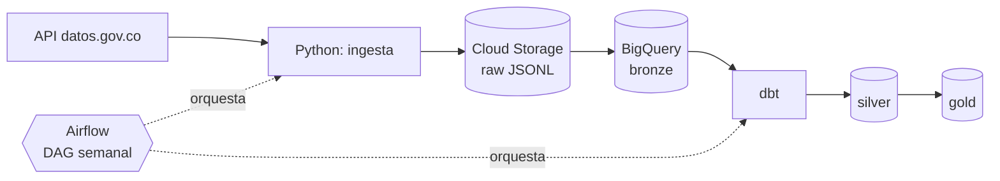
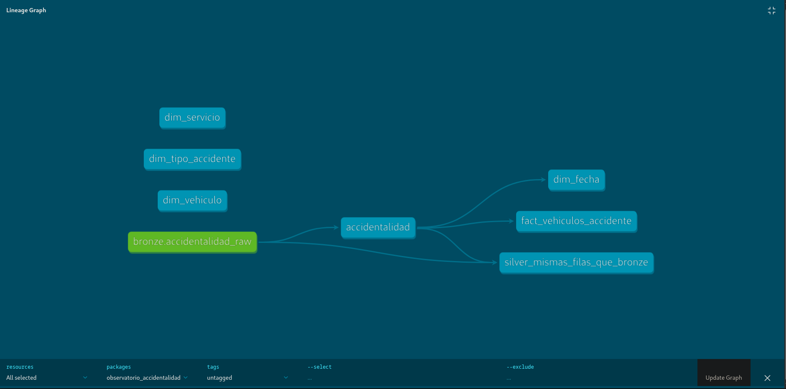

# Pipeline de accidentalidad vial de Barranquilla


*End-to-end data pipeline for Barranquilla's open road-accident data (2018–present): API ingestion, raw storage in Google Cloud Storage, a layered BigQuery warehouse (bronze → silver → gold) with a star schema, dbt transformations and tests, Airflow orchestration, and Terraform-managed infrastructure.*

Pipeline de datos de extremo a extremo con los datos abiertos de accidentalidad vial de Barranquilla (2018 a hoy): ingesta desde la API de datos.gov.co, almacenamiento crudo en Google Cloud Storage y una bodega de datos en BigQuery organizada por capas (bronze, silver y gold) con un modelo en estrella. Las transformaciones y pruebas de calidad se hacen con dbt, la ejecución semanal la orquesta Airflow y la infraestructura está descrita con Terraform.

## Qué responde este proyecto

- ¿Qué tipos de vehículo participan más en los accidentes?
- ¿Cómo varía el total por año, mes y día de la semana?
- ¿Cómo evolucionan los atropellos y la participación de las motocicletas?
- ¿Cómo se reparten los casos por tipo de accidente y servicio del vehículo?

## Arquitectura



La infraestructura (bucket, datasets, cuenta de servicio y permisos) está descrita en `terraform/`.

| Capa | Contenido |
|---|---|
| **Raw (bucket)** | Archivo tal como lo entrega la API, inmutable, en carpetas por fecha de ingesta |
| **Bronze** | Copia en BigQuery del archivo crudo, todo como texto. Se reemplaza por completo en cada carga |
| **Silver** | Tipos correctos, textos normalizados, nulos explícitos. No descarta filas |
| **Gold** | Modelo en estrella: una tabla de hechos y cuatro dimensiones |

Mapa de dependencias generado por dbt:



Las tres dimensiones sin flechas (`dim_servicio`, `dim_tipo_accidente`, `dim_vehiculo`) son listas de referencia escritas a mano. La tabla de hechos se une a ellas por valor, y su integridad la vigilan las pruebas `relationships`.

## Fuente de datos

Dataset "Accidentalidad Barranquilla, detalle de vehículos" (datos.gov.co, id `nfa3-wgxy`): 51.483 filas, del 2018-01-01 al 2026-06-16, 6 columnas.

## Modelo de datos (gold)

- `fact_vehiculos_accidente`: una fila por combinación de fecha, dirección, tipo de accidente, servicio y clase de vehículo. Métrica: `vehiculos_involucrados`.
- Dimensiones: `dim_fecha`, `dim_vehiculo`, `dim_tipo_accidente`, `dim_servicio`.
- 23 pruebas de calidad en dbt (claves únicas, valores no nulos, valores permitidos, integridad entre hechos y dimensiones y conciliación entre bronze y silver).

## Documentación

- [Perfil de datos](docs/perfil_de_datos.md): qué representa cada fila, calidad, preguntas abiertas y limitaciones.

## Hallazgos y decisiones sobre los datos

- **`cantidad_accidentes`**: los datos sugieren que cuenta los vehículos de una misma clase y servicio en un evento (el 91 % de los choques suma 2 y el 96 % de los atropellos suma 1), no accidentes. Sin confirmación oficial, la métrica se llama `vehiculos_involucrados`.
- **Duplicados**: 6 combinaciones aparecen dos veces. No se eliminan: probablemente son accidentes distintos y el dataset no tiene identificador.
- **Caída desde 2023**: las filas bajan de forma brusca y sostenida (6.653 en 2022, 2.963 en 2023). No se explica con los datos; puede ser un cambio en el registro. Pendiente de investigar.
- **Año 2026 incompleto**: marcado en `dim_fecha.es_anio_completo`.
- `MOTOCARRO` y `CUADRICICLO` se clasifican como motocicletas.

## Cómo ejecutarlo

### Requisitos

- Python 3.11, Git y Google Cloud CLI
- Terraform (para crear la infraestructura)
- Un proyecto de Google Cloud
- Un app token gratuito de datos.gov.co (Socrata)

### 1. Configuración

```bash
python3 -m venv .venv && source .venv/bin/activate
pip install -r requirements.txt
cp .env.example .env          # completa SOCRATA_APP_TOKEN, GCP_PROJECT_ID, GCS_BUCKET
gcloud auth application-default login
```

### 2. Infraestructura (Terraform)

```bash
cd terraform
terraform init
terraform plan
```

Describe el bucket, los datasets `bronze`, `silver` y `gold`, la cuenta de servicio y sus permisos. En un proyecto nuevo, cambia los valores de `variables.tf` (los nombres de bucket son únicos en el mundo) y ejecuta `terraform apply`. En el proyecto original los recursos ya existían y se adoptaron con `terraform import`. El permiso para actuar como la cuenta de servicio (Service Account Token Creator) se otorga a mano, porque llevaría un correo personal.

### 3. Pipeline, paso a paso

```bash
python src/revisar_datos_nuevos.py   # termina con código 99 si no hay datos nuevos
python src/descargar_data.py         # API -> archivo local
python src/subir_a_bucket.py         # archivo -> Cloud Storage
python src/cargar_a_bigquery.py      # bucket -> BigQuery bronze (usa la fecha de hoy;
                                     # --fecha AAAA-MM-DD para otra carpeta de ingesta)
```

### 4. Transformaciones (dbt)

Perfil en `~/.dbt/profiles.yml` (fuera del repositorio):

```yaml
observatorio_accidentalidad:
  target: dev
  outputs:
    dev:
      type: bigquery
      method: oauth
      project: FullProject
      dataset: dbt_dev
      location: us-central1
      threads: 4
      maximum_bytes_billed: 1000000000
    prod:
      type: bigquery
      method: oauth
      project: FullProject
      dataset: analytics
      location: us-central1
      threads: 4
      maximum_bytes_billed: 1000000000
```

```bash
cd dbt
dbt run --target prod    # construye silver y gold
dbt test --target prod   # ejecuta las pruebas de calidad
```

Sin `--target`, dbt escribe en `dbt_dev_silver` y `dbt_dev_gold` (espacio de pruebas). Una macro (`generate_schema_name`) hace que en `prod` los modelos caigan en `silver` y `gold`.

### 5. Orquestación (Airflow)

Airflow vive en su propio entorno, aparte del del pipeline, y las tareas llaman a los scripts con el Python de `.venv` (que debe existir, con las dependencias instaladas).

```bash
python3 -m venv .venv-airflow && source .venv-airflow/bin/activate
pip install "apache-airflow==3.3.2" \
  --constraint "https://raw.githubusercontent.com/apache/airflow/constraints-3.3.2/constraints-3.11.txt"

# Credenciales de la cuenta de servicio (impersonación, sin llaves), en un archivo aparte
CLOUDSDK_CONFIG=$HOME/.config/gcloud-observatorio \
  gcloud auth application-default login \
  --impersonate-service-account=pipeline-accidentalidad@FullProject.iam.gserviceaccount.com

export AIRFLOW_HOME="$(pwd)/airflow"
export AIRFLOW__CORE__LOAD_EXAMPLES=False
export GOOGLE_APPLICATION_CREDENTIALS="$HOME/.config/gcloud-observatorio/application_default_credentials.json"
airflow standalone
```

La interfaz queda en http://localhost:8080. El DAG `accidentalidad_semanal` corre los lunes a las 6:00 y sigue este orden:

`revisar_datos_nuevos` → `descargar` → `subir_a_bucket` → `cargar_bronze` → `dbt_run` → `dbt_test`

La primera tarea compara el total de filas de la API con el de bronze. Si son iguales, termina con código 99 y Airflow omite el resto sin error. Si la API falla, la tarea falla y reintenta (no se confunde con "sin datos nuevos").

## Estructura

```
src/        pipeline de ingesta y carga
dbt/        modelos de silver y gold, pruebas y documentación
airflow/    DAG semanal (los archivos generados por Airflow no se versionan)
terraform/  infraestructura como código
.github/    CI con GitHub Actions
scripts/    exploración y pruebas de conexión
docs/       documentación y perfil de datos
```

## Decisiones de diseño

- **Recarga completa de bronze** en cada ejecución: el dataset es pequeño (51 mil filas; `dbt run` tarda unos 16 segundos) y crece poco. Evita duplicados y corrige solo los cambios de la fuente. La carga incremental (ventana de meses más recarga completa periódica) se evaluó y se descartó por ahora.
- **Detección de datos nuevos** comparando el total de filas de la API con el de bronze; si coinciden, el flujo se omite. Limitación: no detecta correcciones que no cambien el total.
- **Frecuencia semanal**: la fuente se publica con meses de retraso y la revisión es una sola petición pequeña.
- **Autenticación sin llaves**: el pipeline usa una cuenta de servicio con impersonación y permisos mínimos. No hay llaves JSON ni secretos en el repositorio (`.env` y credenciales quedan fuera de Git).
- **Terraform sobre infraestructura existente**: el bucket, los datasets, la cuenta de servicio y sus permisos se adoptaron con `terraform import`. El estado es local y no se versiona.
- **CI sin credenciales por ahora**: valida el código (`ruff`) y que el proyecto dbt se entienda (`dbt parse`). Ejecutar dbt contra BigQuery exigiría autenticación sin llaves y datasets propios de CI, para no tocar producción.

## Limitaciones conocidas

- No hay identificador de accidente: los "accidentes" solo pueden aproximarse.
- Los datos no incluyen gravedad, hora ni coordenadas.
- La normalización de direcciones está pendiente.

## Estado y próximos pasos

- [x] Ingesta paginada desde la API, con reintentos y verificación de conteo
- [x] Carga a bucket con verificación de integridad
- [x] Carga a BigQuery idempotente (reemplazo total de bronze)
- [x] Silver y gold
- [x] Transformaciones con dbt y pruebas de calidad
- [x] Orquestación con Airflow: DAG semanal que detecta datos nuevos y omite el resto si no los hay
- [x] Prueba completa del DAG de punta a punta con la cuenta de servicio
- [x] Infraestructura como código (Terraform)
- [x] CI con GitHub Actions (ruff y validación de dbt)
- [ ] CI: `dbt run` y `dbt test` contra BigQuery, con autenticación sin llaves
- [ ] Pruebas en Python (`pytest`)
- [ ] Alertas de fallo
- [ ] Dockerizar Airflow
- [ ] Normalización de direcciones y dimensión de lugar
- [ ] Dashboard público (Power BI)
- [ ] Carga incremental (evaluada; no necesaria con el volumen actual)